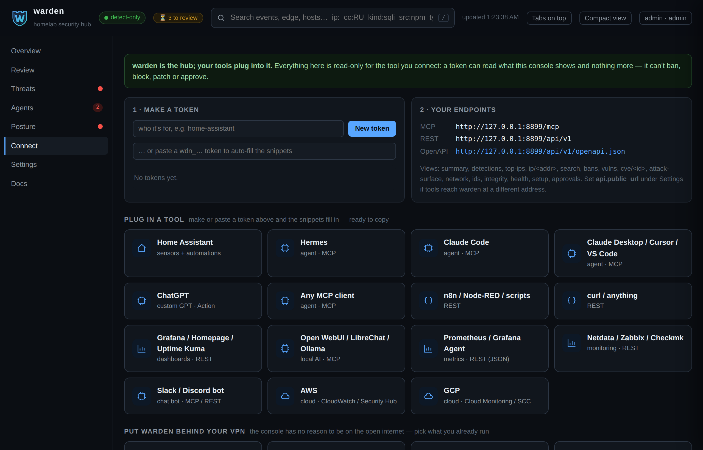
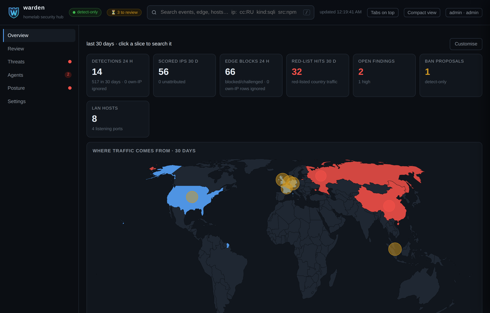
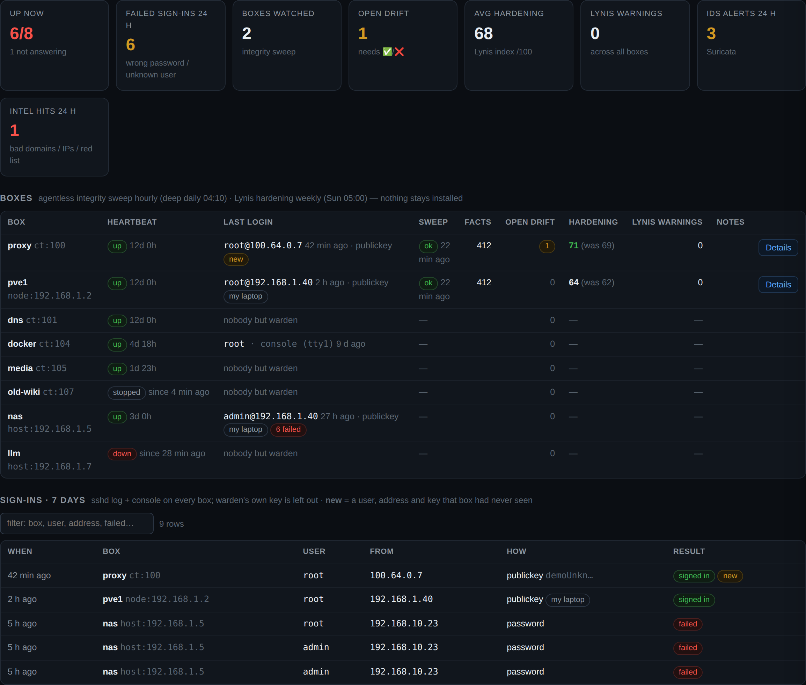
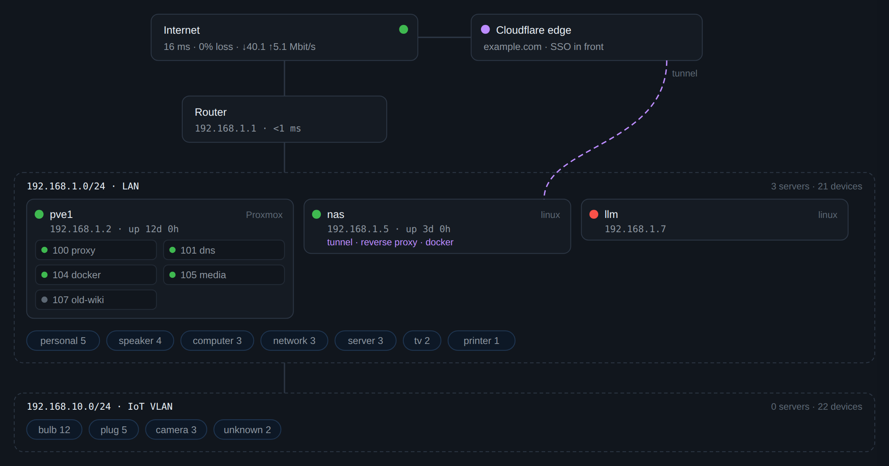

# Changelog

warden's release history. The [README](README.md) is the home page — it covers
what warden does today and how to run it; this file is what changed, and when.

## v3.4

**AI recommendations for the approval queue.** For every pending approval, a
model reads the facts warden has already gathered and returns a ✅ (approve) or
❌ (reject) with a one-line reason. It recommends, never decides: the model
weighs facts that detectors collected, so the rule "scripts gather facts, models
never invent them" still holds, and you still press the button. Answers are
cached per approval id, so a page refresh does not re-call the model. The
console gains **Approve all**, **Recommend** and **Apply AI picks** buttons over
a read-only `/api/recommend` endpoint. Configure it under the same `vuln.brief`
block as the vulnerability briefing.

**`patch.window_hook`.** An optional command that runs as
`<cmd> start|end <target> <vmid> <node> <name>` around every patch job (the
`end` runs in a `finally`), so a site can pause its own monitoring and
auto-healing while a box is being patched. Hook failures never block a patch —
they are logged and the patch continues.

**"database is locked" fixed.** Several collectors held `warden.db`'s write
lock across slow work, so one long scan blocked every other warden job. The
OSV collector now commits before its network fetch and batches its writes into
one short transaction; the LAN sweep completes every network before its first
insert and commits before the multi-minute port scan; and a container sweep is
capped at 60s so one hung `pct exec` cannot stall the run.

## v3.3

Plug anything into warden, and find your way around it.

- **Connect tab** — integrations as a tile grid (15 of them: MCP agents, dashboards, local-AI frontends, Prometheus, Netdata/Zabbix/Checkmk, a Slack/Discord bot, and AWS + GCP). Click a tile for its setup; **make or paste a token and every snippet fills in, ready to copy** — no hand-editing.
- **Docs tab** — concise in-app help (what warden is, a tour of each tab, how to connect, the security model), with links out to the full GitHub docs.
- **Clearer Agents tab** — the map is now **per-agent lanes** (no crossing lines; known-bad in red, bytes shown), and *"what each agent can access"* is a tidy grid.
- **Overview you can arrange** — the numbers row can be placed anywhere (below host health, under the traffic map) and everything reorders, all in Customise.
- **Reads in any language** — the console is plain, labelled HTML, so your browser translates it; commands, IPs and config keys are left intact.
- **Merged fixes** — package types inside container images, a tested OUI "never guess a vendor" contract, and `pct exec`/`lxc-attach`/web-console sign-ins now recorded.

## v3.2

A much simpler console, and the database is now private at rest.

- **Navigation simplified — 16 tabs became 6.** Overview, Review, Threats, Agents, Posture, Settings. Related views sit under a sub-nav; a primary tab shows a small dot when something inside needs you, and the detailed counts live where they have context.
- **"Review"** is the renamed, dedicated approval queue (was "Waiting for you"), out of Settings and compact.
- **Account consolidation** — your API/MCP tokens, endpoints, integration snippets and VPN guidance now live under **Settings → Account**.
- **Readable settings** — each editable field shows a plain-English label (e.g. "Cloudflare Zone ID") with the raw `warden.yml` key dimmed beneath it.
- **Database private at rest** — `warden.db` and its WAL/journal are owner-only (`0600`), re-enforced on every start, so a shared host never leaks logs, session hashes or (in local auth) the TOTP seed. API tokens remain SHA-256, passwords scrypt, and secrets never touch the database.
- A safe in-place deploy script (`tools/deploy.sh`) that never overwrites your config, secrets or data.
- **Reads in any language** — the console is plain, labelled HTML, so your browser's built-in *Translate page* renders it in any language; commands, IPs and config keys are marked non-translatable so they're never mangled.

## v3.1

- **The incident brain, released.** Every detector — edge, logs, LAN, vulnerabilities, integrity, agents — is joined into one picture per entity, and in **shadow mode** the model writes down what it *would* do and how sure it is, and never carries it out. Now its own **Incidents** tab, so you can watch what it gets right before you ever let it act.
- **Watch any AI agent, not just Hermes.** Agent tracking is now generic: name your own agents — a ChatGPT or Muse bridge, a custom bot, any runtime — with `agents.patterns` in `warden.yml`. The **Agents** tab adds a **map** of each agent and where it reaches, an **access panel** (the user it runs as, its groups, Linux capabilities, sudo rights and which configured secret files it could read — all read-only), and a **destination history** across every agent, known-bad first, with best-effort bytes so a real download is visible, not just a connection.
- **A console that's easier to live in.** A **"Waiting for you"** button in the header gathers everything needing your ✅ / ❌ in one place; a no-AI **query builder** on Search composes `type:`/`kind:`/`cc:`/`date:` filters (now with negation, e.g. `-kind:challenge`); the **Connect** tab plugs in any assistant (Claude, ChatGPT, Cursor, a generic MCP client, curl) with copy-paste blocks; and **Settings** is tidied into a labelled section per subsystem.
- **Still lightweight.** No new runtime dependencies — the agent map, access panel and byte counts are the same read-only `ss`/`/proc` collector doing a little more, and the console stays vanilla inline JS. Footprint is essentially unchanged.

## v3.0

- **A heartbeat for every box.** Every 5 minutes: up, down, stopped or unknown, and for how long. One SSH call per Proxmox node answers for the node *and* every container on it, so twenty containers cost one sign-in, not twenty. A box that misses three beats sends one message, and another when it's back, saying "it rebooted" when the uptime shows it. If a node stops answering, its containers show as unknown rather than down, so one dead node is one message.
- **Who last signed in, to every box.** SSH and console sign-ins from each box's own log, the failed ones counted, and a 7-day list. A `pct exec`, `lxc-attach` or Proxmox web-console session writes no log line, so warden also reads each box's process table and records one still open as an `attach` sign-in. Sign-ins made with warden's own key are left out, otherwise every box would always say "warden, 4 minutes ago" (on the author's estate that was about three sign-ins in four). Name your other automation keys and they show as jobs, not people. After a silent first read, a user, address and key a box has never seen sends a message.
- **A live network map.** Internet and line health, the router, the Cloudflare edge and the box running the tunnel, each subnet with your servers (containers under their node, coloured by heartbeat), and every other device counted by kind. It's drawn from data warden already has, so it changes when the network does, and it reads on a phone.
- **No scanner binary.** trivy is gone, after its own v0.69.4 release and v0.69.5/6 images turned out to be malicious (CVE-2026-33634). Vulnerabilities now come straight from [OSV.dev](https://osv.dev), ranked by CISA known-exploited, then FIRST EPSS, then severity with a fix. Debian security notices are expanded so older releases don't look clean. An optional AI "fix first" briefing is withheld if it names anything that isn't in the scan.
- **What the internet can reach.** Vulnerable containers and boxes that are publicly reachable are marked and ranked first.
- **Every device in the house.** One inventory from the LAN sweep, the router's leases and Home Assistant, each device with a kind and the reason for it. warden learns what each bulb, plug, TV or camera normally looks up, scores anything new, and asks you only about the odd ones.
- **Internet health once a minute.** Router, internet, DNS and web checks, plus line usage and the busiest devices when it goes bad, so "the internet was slow" has a cause.
- **An attack map** of where traffic comes from, by country, on the home page.
- **More log formats** (Caddy, Traefek, Authentik), an optional [Beszel](https://github.com/henrygd/beszel) host-health card, and a [setup guide](docs/SETUP.md) that CI runs every week.

*Both on demo data: `WARDEN_CONF=tools/demo.yml python3 tools/demo.py` (private and documentation addresses only).*

## v2.0

- **Its own sign-in.** Users with viewer, approver and admin roles, optional 2FA from any authenticator app, lockout after repeated failures, and a sign-in log. No web sign-up: the first admin is made on the command line. Prefer your SSO? `ui.auth: proxy` keeps it.
- **Runs on your estate, not the author's.** Machines, log sources, alerts and secrets are all in `warden.yml`. `warden-setup init` writes it for you.
- **An MCP connector and a REST API**, both read-only and token-protected, so Hermes, Claude, Cursor or a script can ask "what's attacking me?" and get real data back.
- **A home page you can arrange**: pick which numbers, pies, timelines and tables appear, and in what order.
- **Approvals without chat**: Discord reactions still work, and now the dashboard's Settings tab can approve or reject too, so a webhook or ntfy setup gets the full feature set.
- **Eleven more modules**: vulnerability scanning, patch proposals, file integrity, hardening audits, network IDS, router threat-intel, Cloudflare edge blocklist and more.
- **A setup check that asks the running system.** A key that stopped working shows as missing, not ticked.
