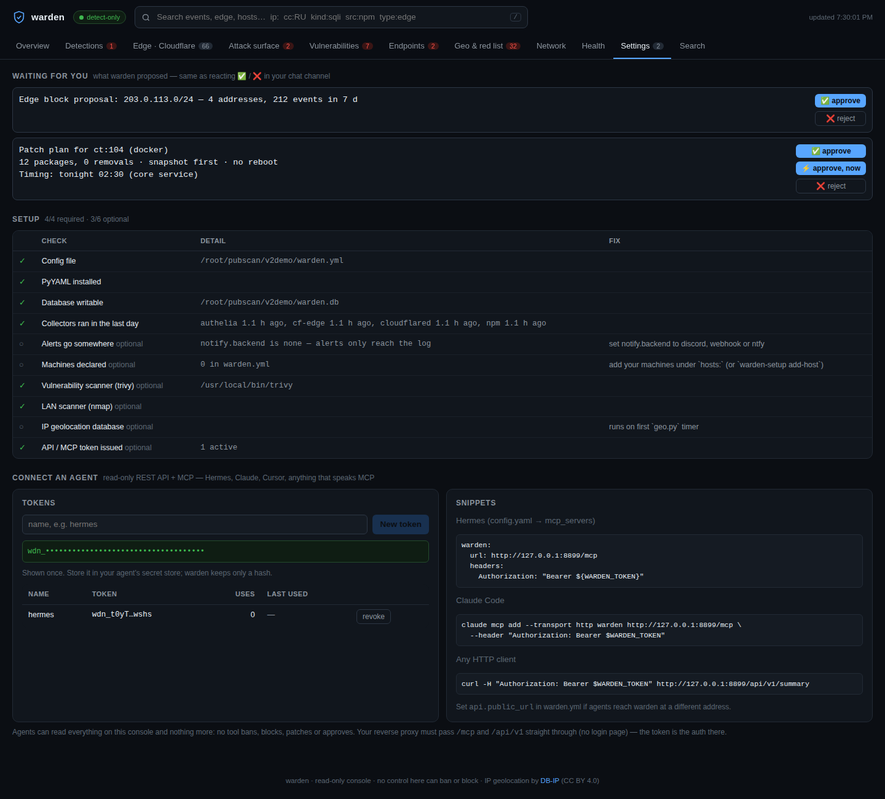
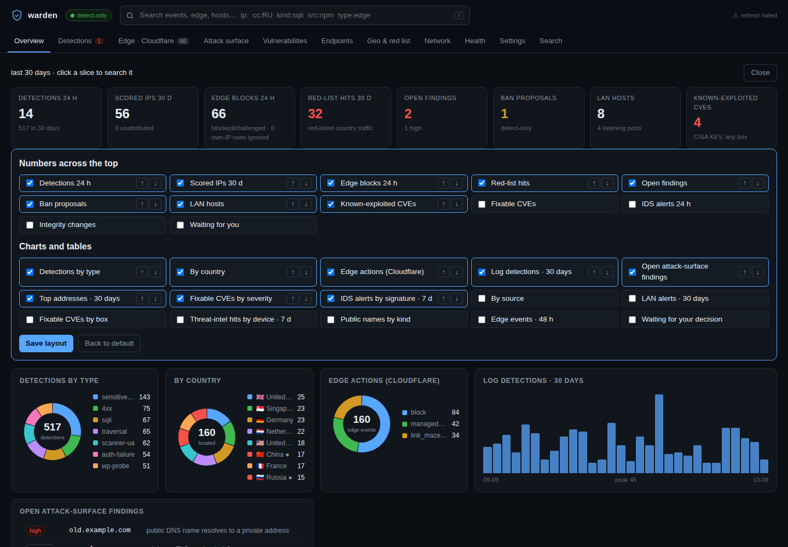
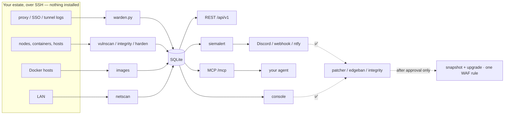

<h1> warden</h1>

A lightweight, self-hosted security console for a homelab or small estate. It reads the logs your WAF can't see, sweeps your LAN, scans your machines and containers for vulnerabilities, watches files for drift, tracks AI agents, and lets your agent ask it questions over MCP — detect-only until you approve.


*The Overview on demo data (`tools/demo.py`: documentation addresses only). Every chart and number on it can be swapped. See [Make the home page yours](#make-the-home-page-yours).*

    [](https://buymeacoffee.com/iamc_tech) [](https://asareanderson.gumroad.com/l/ynfgq)

## Contents

- [What's new in v3.4](#whats-new-in-v34)
- [What's new before v3.4](#whats-new-before-v34)
- [What it does](#what-it-does)
- [How it compares](#how-it-compares)
- [Minimum spec](#minimum-spec)
- [Quick start](#quick-start)
- [Usage](#usage)
- [Connect your agent (MCP and REST)](#connect-your-agent-mcp-and-rest)
- [Make the home page yours](#make-the-home-page-yours)
- [Approvals](#approvals)
- [Configuration](#configuration)
- [How it works](#how-it-works)
- [Incidents (shadow mode)](#incidents-shadow-mode)
- [Security model](#security-model)
- [Status, limits and real results](#status-limits-and-real-results)
- [Roadmap](#roadmap)
- [Support and licence](#support-and-licence)

## What's new in v3.4

The approval queue gets a second opinion, and a patch can ask your monitoring to hold its fire.

- **AI recommendations for the approval queue** — for every pending approval, a model reads the facts warden has already gathered and returns a ✅ (approve) or ❌ (reject) with a one-line reason. **It recommends, never decides**: the model weighs facts that detectors collected, so the rule "scripts gather facts, models never invent them" still holds, and you still press the button. Answers are cached per approval id, so a page refresh does not re-call the model. The console gains **Approve all**, **Recommend** and **Apply AI picks** buttons over a read-only `/api/recommend` endpoint. Configure it under the same `vuln.brief` block as the vulnerability briefing.
- **`patch.window_hook`** — an optional command that runs as `<cmd> start|end <target> <vmid> <node> <name>` around every patch job (the `end` runs in a `finally`), so a site can pause its own monitoring and auto-healing while a box is being patched. **Hook failures never block a patch** — they are logged and the patch continues.
- **"database is locked" fixed** — several collectors held warden.db's write lock across slow work, so one long scan blocked every other warden job. The OSV collector now commits before its network fetch and batches its writes into one short transaction; the LAN sweep completes every network before its first insert and commits before the multi-minute port scan; and a container sweep is capped at 60s so one hung `pct exec` cannot stall the run.

## What's new before v3.4

Release history lives in [CHANGELOG.md](CHANGELOG.md): v3.3 (Connect and Docs
tabs, per-agent lane map, arrangeable Overview, browser-translate), v3.2 (six
tabs, the database private at rest), v3.1 (the incident brain, generic agent
tracking), v3.0 (the heartbeat, sign-ins, the network map, OSV.dev instead of a
scanner binary) and v2.

## What it does

- **Log detection** (`warden.py`) — Scores reverse-proxy, SSO and tunnel logs (path traversal, `.env`/`.git` probes, SQLi, scanner agents, auth failures). Proposes per-IP and /24 bans. Never bans you, private ranges or Cloudflare.
- **LAN** (`netscan.py`) — ARP discovery every 15 min, daily port sweep, new-device, IP-conflict and new-port alerts, with a learning window so sleeping bulbs don't page you.
- **Vulnerabilities** (`vulnscan.py`, `images.py`) — Agentless: copies only the package database off each box and matches it against [OSV.dev](https://osv.dev), plus Alpine's own secdb, and reads the OS, Python, npm, Go and Rust packages inside the images of running containers. Ranked CISA known-exploited > likely to be exploited (FIRST EPSS ≥ 10% with a fix) > critical with a fix > the rest, and boxes the internet can reach come first. An optional AI "fix first" list is withheld if it names anything not in the scan. Also checks NAS firmware against the vendor's latest release.
- **Patching** (`patcher.py`) — Turns a request into a plan (packages, removals, snapshot, reboot) and waits for your ✅. Snapshots containers first. Holds core services for the night window. Never auto-reboots a hypervisor.
- **Heartbeat and sign-ins** (`heartbeat.py`) — Is every box up (one call per Proxmox node covers its containers), who last signed in over SSH, the console or a still-open `pct exec` / `lxc-attach`, failed sign-ins, and down/back/reboot messages. warden's own key is left out.
- **Endpoint drift** (`integrity.py`, `harden.py`) — Agentless file and config baselines with ✅-to-accept; weekly Lynis hardening score per box (run from a temp dir, nothing left installed).
- **Devices and internet** (`devices.py`, `devicewatch.py`, `netwatch.py`) — One inventory of every device (sweep, router leases, Home Assistant) with its normal behaviour learned and anything new scored; internet health every minute with line usage and the busiest devices.
- **AI agents** (`agents.py`) — Attributes every outbound connection on each agent host to the agent that made it, checks each destination against the threat feeds, flags an agent reaching a host it has never used, records what each agent can access (user, groups, Linux capabilities, sudo, readable secret files), and keeps a destination history. Detect-only, read-only.
- **Network IDS** (`netids.py`, `netintel.py`) — Pulls Suricata alerts; checks router DNS and connection logs against threat feeds. Both optional.
- **Edge** (`intel.py`, `edgeban.py`, `cfsec.py`, `edge-sentry/`) — Cloudflare edge events, an attack-surface snapshot, a proposed edge blocklist, a zone audit, and a report-only Worker. All optional.
- **Alerts** (`siemalert.py`, `wlib/notify.py`) — New findings to Discord, a webhook or ntfy, with self-report suppression.
- **Console** (`warden-ui.py`, `wlib/auth.py`) — Tabs, sign-in with roles and 2FA, unified search with a no-AI query builder, a summary of everything needing your ✅ / ❌, per-collector health, a customisable home page, settings grouped by subsystem, and approvals.
- **Agent access** (`wlib/mcp.py`, `/api/v1`) — Read-only MCP tools and the same views over REST.

Every optional feature switches itself off when it isn't configured. A box with no Cloudflare zone never runs the Cloudflare jobs.

## How it compares

Every piece of warden exists somewhere else, often done better. What warden adds is the combination: no agents on your machines, one small box (1 vCPU, 512 MB), Cloudflare edge bans worked out from the logs you already have, and nothing banned or patched until a person says yes. It's meant to sit next to these tools, not replace them.

**What makes warden different** — the tools above are broader and more mature in their own areas; this is where warden isn't like them:

- **Detect-only by default.** warden *proposes* — a ban, a patch, a country block — and nothing happens until you ✅ it, in chat or in the console. Fail2ban, CrowdSec's bouncers and Wazuh's active response all act on their own. warden is built for the case where you want the judgement, not the reflex.
- **AI-native.** Every view is an [MCP](#connect-your-agent-mcp-and-rest) tool and a REST endpoint, so any assistant — Claude, ChatGPT, Cursor, your own bot — can ask "what's attacking me?" and get real data. On top of that sits the **incident brain**, which correlates every detector into one picture per entity and, in shadow mode, reasons about what it *would* do so you can judge it before it ever acts. None of the tools above ship either.
- **It watches your AI agents.** warden attributes outbound connections to the agent that made them, maps where each one reaches, records what it can access (user, groups, Linux capabilities, sudo, readable secrets) and flags any known-bad destination. If you run autonomous agents, nothing else here does this.
- **Agentless, dependency-free, 512 MB.** No agent on your hosts, no Postgres/Redis/Elastic, Python standard library plus a little. Built for a homelab, not an enterprise SOC — Wazuh wants 4 vCPU / 8 GB, Security Onion far more.
- **One tool, many layers.** Logs *and* LAN *and* vulnerabilities (ranked by what's actually running and exploited, no scanner binary) *and* file integrity *and* the Cloudflare edge *and* your agents — joined up, instead of one box per concern.

| Tool | What it does well | How warden differs | Licence |
|---|---|---|---|
| [Wazuh](https://github.com/wazuh/wazuh) | Full SIEM/XDR: vulnerability detection, file integrity, config checks, active response | Wazuh puts an agent on every host, and its all-in-one install asks for [4 vCPU and 8 GB](https://documentation.wazuh.com/current/quickstart.html). warden is agentless and much smaller, and does much less. | GPL-2.0 |
| [CrowdSec](https://github.com/crowdsecurity/crowdsec) | Log parsing, community blocklists, bouncers that block automatically | CrowdSec's bouncers act on their own. warden asks first, and was built for a Cloudflare tunnel, where a local firewall ban never matches the attacker's packets. warden runs happily alongside it. | MIT |
| [PatchMon](https://github.com/PatchMon/PatchMon) | Patch management with approvals and Proxmox LXC auto-enrolment | PatchMon needs an agent per host plus Postgres and Redis. warden patches over SSH and also does detection, IDS and edge bans. | AGPL-3.0 |
| [Vuls](https://github.com/future-architect/vuls) | Agentless vulnerability scanning over SSH | Vuls is a scanner. warden does the same job against OSV.dev with no scanner binary, and adds patch plans, detection and approvals around it. | GPL-3.0 |
| [Security Onion](https://github.com/Security-Onion-Solutions/securityonion) | Network security monitoring, Suricata, hunting | Security Onion is a full platform with [much bigger hardware needs](https://docs.securityonion.net/en/2.4/hardware.html). warden just reads alerts from a Suricata you already run. | Elastic License 2.0 |
| [BunkerWeb](https://github.com/bunkerity/bunkerweb) | A reverse proxy + WAF with bad-IP blocklists | BunkerWeb *is* your proxy. warden reads the logs of the proxy you already have. | AGPL-3.0 |
| [Fail2ban](https://github.com/fail2ban/fail2ban) | Bans from log patterns | Single-purpose, bans automatically, and behind a tunnel its firewall bans hit the tunnel, not the attacker. | GPL-2.0 |

Vulnerability data comes from [OSV.dev](https://osv.dev); host hardening and network IDS are done by [Lynis](https://cisofy.com/lynis/) and [Suricata](https://suricata.io/); warden joins their results up. Compared from each project's own docs in October 2026. If something here is out of date or unfair, open an issue and I'll fix it.

## Minimum spec

Measured on the author's running install (Ubuntu 24.04, Python 3.12, an LXC container watching two Proxmox nodes, a NAS, ~50 LAN devices and 15 containers), October 2026:

| Recommended | Core (detection, LAN, console, API, MCP) | Plus vulnerability scanning |
|---|---|---|
| CPU | 1 vCPU | 1–2 vCPU |
| RAM | 512 MB | 1.5 GB |
| Disk | 300 MB | 2.5 GB |
| Measured | console 29 MB resident (70 MB peak); warden + its data 122 MB | trivy server 89 MB resident, its database cache 1.4 GB, binary 161 MB; the daily scan used 24 CPU-seconds (its memory peak was not measured, hence the headroom) |

- **OS:** Linux with systemd and Python 3. Tested on Ubuntu 24.04 (Python 3.12) and Debian 13 (Python 3.13), x86_64. Other distros and arm64 should work but are untested.
- **Packages:** `python3-yaml`, `python3-requests`; `nmap` for LAN discovery. Vulnerability scanning needs no extra software: outbound HTTPS to api.osv.dev and secdb.alpinelinux.org, and `python3` on docker hosts (for the image collector, fed over SSH; nothing is installed).
- **Access:** SSH keys to the machines you want scanned. Nothing is installed on them.
- **Why not trivy:** warden used trivy until 2026-10-10. Its 0.69.4 release and 0.69.5/0.69.6 images were malicious (CVE-2026-33634), and it needed a 161 MB binary, a 1.4 GB database and a server. OSV.dev gives the same advisories with nothing to download or keep patched.

## Quick start

Full step-by-step setup, tested every week on a fresh machine: [docs/SETUP.md](docs/SETUP.md).

```sh
git clone https://github.com/casareanderson/warden.git /opt/warden
cd /opt/warden
sudo apt install python3-yaml python3-requests nmap
./warden-setup init                 # estate, alerts, machines, Cloudflare → warden.yml
./warden-setup check --hosts        # asks the running system what works
sudo ./warden-setup units --install # writes + enables only the timers for features you use
```

Then make yourself an admin and open the console:

```sh
./warden-setup user add YOUR-NAME --role admin   # prints a one-time password; you pick your own at first sign-in
```

The console binds to `127.0.0.1:8792`; put HTTPS (a reverse proxy) in front of it. It has its own sign-in page with roles and optional 2FA. If your proxy already signs people in (Authelia, Authentik, oauth2-proxy), set `ui.auth: proxy` instead.

Want to look before you wire anything up?

```sh
WARDEN_DATA=/tmp/warden-demo python3 tools/demo.py
WARDEN_DATA=/tmp/warden-demo ./warden-setup user add demo --role admin
WARDEN_DATA=/tmp/warden-demo python3 warden-ui.py   # http://127.0.0.1:8792, sign in as demo
```

## Usage

The systemd timers run the collectors on their own. To run one by hand:

| Command | What it does |
|---|---|
| `python3 warden.py` | Collect logs, score events, propose bans |
| `python3 vulnscan.py` | Scan hosts and container images against OSV.dev |
| `python3 netscan.py` | ARP discovery and port sweep |
| `python3 patcher.py` | Build patch plans from outstanding requests |
| `python3 integrity.py` | Run file-baseline comparisons |
| `python3 harden.py` | Weekly Lynis hardening audit (`--list` scores) |
| `python3 agents.py` | Track outbound connections on an agent host |
| `python3 incidents.py` | Correlate detectors into incidents (`--report` measures accuracy) |
| `python3 heartbeat.py` | Ping every box, record who signed in |

Check the configuration without applying anything:

```sh
./warden-setup check --hosts          # verify SSH connectivity
./warden-setup check --all            # include optional integrations
```

Start or stop the console:

```sh
sudo systemctl enable --now warden-console.service
sudo systemctl disable --now warden-console.service
```

## Connect your agent (MCP and REST)



1. Mint a token: **Settings → Connect an agent → New token**, or `./warden-setup token hermes`. It's shown once; warden stores only its hash.
2. Point your agent at `/mcp`:

```yaml
# Hermes: ~/.hermes/config.yaml → mcp_servers
warden:
  url: https://warden.example.com/mcp
  headers:
    Authorization: "Bearer ${WARDEN_TOKEN}"
```

```sh
# Claude Code
claude mcp add --transport http warden https://warden.example.com/mcp --header "Authorization: Bearer $WARDEN_TOKEN"
# anything else
curl -H "Authorization: Bearer $WARDEN_TOKEN" https://warden.example.com/api/v1/summary
```

**Tools:** `warden_summary` (start here), `warden_detections`, `warden_top_ips`, `warden_lookup_ip`, `warden_search`, `warden_bans`, `warden_vulnerabilities`, `warden_attack_surface`, `warden_network`, `warden_ids`, `warden_integrity`, `warden_health`. The REST views mirror them at `/api/v1/<view>`; `/api/v1/openapi.json` describes them.

**Read-only, enforced by a test.** No tool can ban, block, patch or approve. A model that can reach your firewall through a chat window is a different risk class; it can tell you what to do, and you decide.

If your reverse proxy has a login page, let `/mcp` and `/api/v1` straight through. An MCP client has no browser and can't follow a login redirect; the bearer token is the auth on those two paths.

## Make the home page yours



Press **Customise** on the Overview. Tick the numbers and charts you want, use ↑ ↓ to order them, and **Save layout**. Fifteen charts and tables and twelve headline numbers are available, including fixable CVEs, known-exploited CVEs, IDS alerts, threat-intel hits, integrity changes and decisions waiting for you. The layout is stored in warden's database, so it survives upgrades, and **Back to default** undoes it. It works on a phone too (no sideways scrolling at 390 px).

**Host health (optional).** If you already run [Beszel](https://github.com/henrygd/beszel) for CPU, RAM, disk and temperature, set `beszel.enabled: true` and a **Host health · Beszel** card appears on the Overview: all OK, or which machines are over their Beszel thresholds or not reporting. warden doesn't rebuild Beszel. It reads Beszel's verdict, either from a snapshot file (`tools/beszel-snapshot.py`, run on the hub box, reads the hub database read-only) or from the hub's API as a user with Beszel's read-only role. The card shows up once on its own; if you remove it in Customise it stays removed. `warden_summary` (MCP/REST) gains a `host_health` line too.

## Approvals

warden proposes; you decide. Patch plans, edge-block proposals and integrity changes each arrive as a message with ✅ / ❌ (and ⚡ "do it now" for patches).

- **Discord:** react on the message. Only `notify.owner_id`'s reactions count.
- **Anything else (webhook, ntfy, none):** **Settings → Waiting for you** has the same buttons. A dashboard decision counts as the owner's and the first decision wins.

Unanswered proposals expire and nothing changes.

If you set a `vuln.brief` block, the console's **Recommend** button adds a second opinion on every pending item: a model reads the facts warden has already gathered and suggests ✅ or ❌ with a one-line reason. It recommends, never decides — you still press the button, or **Apply AI picks** to take the model's picks in one go.

## Configuration

`warden-setup init` writes `warden.yml`; [warden.yml.example](warden.yml.example) documents every key. The sections:

| Section | What it's for |
|---|---|
| `enforce`, `ban_threshold`, `allow`, … | Detection thresholds and your own IPs (never banned). |
| `estate` | Name, public domain, LAN ranges, timezone, the box warden runs on. |
| `sources` | Where the logs are: `ssh: user@host` (or `local`) and an optional `container`. |
| `hosts`, `roles`, `core` | Machines to scan and patch: `proxmox`, `docker`, `linux` or `local`. Proxmox nodes report their running containers on every run. |
| `notify` | `discord`, `webhook`, `ntfy` or `none`. |
| `secrets` | Names only. Values come from the environment, `data/secrets.env` (mode 600, `warden-setup secret NAME`), Infisical or a command. |
| `cloudflare`, `ids`, `router` | Optional integrations. |
| `vuln.brief` | Optional AI endpoint (any OpenAI-compatible one). Also powers the approval-queue recommendations. |
| `patch` | Patch window, expiry, snapshot retention, and an optional `window_hook` command run around every patch job. |
| `ui`, `api`, `dashboard` | Console bind address and auth, the public URL agents use, and the default home layout. |

## How it works



Everything shares one SQLite file. Collectors run on systemd timers; the console, API and MCP read that file and nothing else. Three lessons built into the detector:

1. **An event's time is the time in the log line.** The first run ingests weeks of backlog; stamped "now", old history would fall inside the ban window.
2. **A fixed `--since 10m` under a 5-minute timer double-counts.** Collectors keep real watermarks plus a content hash against restarts and rotation.
3. **A per-IP threshold misses subnet spread.** The /24 roll-up catches seven addresses each just under the line.

```
warden/
├── warden.py            log collectors, scoring, ban proposals
├── warden-ui.py/.html   console + REST API + MCP
├── warden-setup         init, check, add-host, tokens, connect, units
├── wlib/                config, secrets, notify/approvals, hosts, views, mcp, recommend, tokens, setup, units
├── netscan.py  vulnscan.py  images.py  patcher.py  integrity.py  harden.py
├── intel.py  edgeban.py  cfsec.py  netids.py  netintel.py  siemalert.py  geo.py  warden-facts.py
├── edge-sentry/         report-only Cloudflare Worker (+ 11 offline tests)
├── tools/demo.py        demo data for screenshots and try-outs
├── tests/               175 tests: API, MCP traps, read-only guard, hosts, patch timing, intel
└── KNOWN-ISSUES.md      read before enforce: true
```

## Incidents (shadow mode)

Every detector used to alert on its own: an address probing `/.env` at Cloudflare, failing SSO logins, then signing in
over SSH was three unrelated messages. `incidents.py` (timer, every 10 minutes) joins signals from the log detector,
the Cloudflare edge, Suricata, threat intel, device behaviour, integrity drift, sign-ins and the heartbeat into
incidents: one per outside /24, box or device, with a stable id on every fact. That part is plain code.

Then, **in shadow mode only**, a model (the same endpoint as the vulnerability briefing, `vuln.brief`, or its own
`incidents.model`) picks one action per incident from a fixed list: `ignore_learn`, `watch`, `ask_owner`,
`propose_edge_block`, `propose_patch_now` or `check_box`, with a confidence and two sentences of why that must cite fact
ids. Anything it writes that isn't in the facts (a number, an address, a name, a CVE) gets one repair round and is then
withheld. Decisions are shown in the console (Detections → Incidents) and over MCP/REST, and **never carried out or
sent anywhere**; `incidents.py` doesn't even import the alerting code.

Next to each decision warden records what you actually decided where you did (edge-ban ✅/❌, integrity ✅/❌, device
verdicts), and `incidents.py --report` measures how often the model agreed. It stays in shadow mode until that number
says it's worth trusting. First run on the author's estate: 73 incidents from 7 days, 10 decisions, none withheld, under
a fifth of a US cent; it agreed with the owner on 2 of the 5 incidents the owner had already judged.

```yaml
incidents:
  mode: shadow        # shadow | off
  min_weight: 8       # lighter incidents are listed but never sent to the model
  max_decisions: 20   # model calls per run; unchanged incidents are never re-asked
```

## Security model

- **The console has its own sign-in** (`ui.auth: local`): scrypt-hashed passwords, session cookies stored only as hashes (HttpOnly, SameSite=Strict, Secure behind HTTPS), idle and absolute timeouts, lockout after 5 misses plus a per-address limit, one error message whether the name or the password was wrong, optional TOTP 2FA, and roles checked on the server for every change. There is no web sign-up. Disabling or demoting someone ends their sessions immediately.
- **Detect-only by default.** `enforce: false` records what warden would ban and changes nothing.
- **Nothing acts without you.** Patching, edge blocks and baseline changes each need an explicit ✅, expire if ignored, and are logged with who decided.
- **Agents read; people decide.** MCP and REST are read-only, and a test fails if any tool name contains a write verb.
- **Tokens are hashed at rest** (`wdn_` + 32 random bytes, SHA-256 stored), counted on every use, revocable at once.
- **Browser writes are same-origin only** and need an `X-Warden` header, so a link on another site can't fire them. The console's systemd unit may write only the data directory.
- **Secrets are names in config, never values.** Values live in the environment, a mode-600 file, or your secret manager.
- **Agentless.** Scans copy package metadata off a box; Lynis runs from a temp directory and is removed.

## Status, limits and real results

Status: v3.4, running in detect-only mode on the author's estate since September 2026. It's a second opinion, not a replacement for CrowdSec or a WAF: it reads what they miss.

Measured on that estate:

- **The loudest signal was the owner.** In one week, 27 of 29 application-layer events came from the estate's own WAN address: a phone photo app requesting thumbnails for deleted assets.
- **ARP sees only what is awake.** Two sweeps twelve minutes apart found 48 then 46 devices; six "new" ones were bulbs and a TV that had been asleep. That's why `learn_hours` exists.
- **Percent-encoding defeats a naive WAF rule.** `union select` never matches `union%20select`. Both the Worker and the proposed rule now decode first.
- **Raw CVE counts are mostly noise.** One container had 4,592 findings and 0 with a fix available, which is why the console leads with fixable and known-exploited.

Known limits (full list in [KNOWN-ISSUES.md](KNOWN-ISSUES.md)): the Cloudflare WAF enforcement path (ban and unban alike) is unit-tested but still not battle-tested on a live account; a broken SSH connection to a log host is flagged `blind` on the Health tab rather than reading as a quiet log; log formats assume NGINX/NPMplus, Authelia, cloudflared, Caddy (JSON), Traefik (CLF) and Authentik.

## Roadmap

- **Cloud connectors:** read-only posture checks for your own cloud accounts.
- **An evolve agent:** watches security advisories and tool trends, and proposes improvements to warden's own rules with the same ✅ / ❌ flow.
- **Crawl-aware agent tracking (from ephor v0.2).** Port ephor's crawl-client classification into `agents.py` so the Agents tab labels *how* an agent reaches out — a headless `chromium`/Playwright/Puppeteer, `crawl4ai`, `scrapy`, `curl`, python `requests`, `node` — all read from `/proc`, and tags known crawl/scrape SaaS destinations (e.g. Firecrawl) as a category. Detect-only, stdlib, no new dependency; keeps warden the superset of the standalone ephor.
- **Inbound AI-crawler tracking (edge):** on the Edge·Cloudflare view, identify AI crawlers hitting your own
  public sites by their declared user-agent (GPTBot, ClaudeBot, CCBot, PerplexityBot, Google-Extended, Bytespider,
  Amazonbot, …) and show which bot crawled which hostname, how often, and whether it honoured robots.txt — the
  outbound-agent view's mirror image, for the AI traffic coming *at* you rather than *from* your agents.

## Related tools

warden is the full platform. Two of its engines also ship on their own, for when you want just one piece:

- **[sieve](https://github.com/casareanderson/sieve)** — warden's dependency/CVE scanner as a standalone CLI (OSV.dev + CISA KEV + EPSS, no server).
- **ephor** — warden's AI-agent network monitor as a standalone, passive watcher (coming soon).

## Support and licence

If warden is useful to you, [buy me a coffee](https://buymeacoffee.com/iamc_tech). More field notes at [dev.to/iam-tech](https://dev.to/iam-tech).

Copyright (c) 2026 Christian Asare-Anderson. Licensed under the GNU Affero General Public License v3.0, see [LICENSE](LICENSE). If you run a modified warden as a network service, the AGPL requires you to offer your users the modified source. For a commercial licence without those terms, open an issue.

Versions up to and including commit `48f2ba1` (2026-10-08) were released under MIT and remain available under MIT; everything after is AGPL-3.0 only. IP geolocation by [DB-IP](https://db-ip.com) (CC BY 4.0). `netscan.py` calls [nmap](https://nmap.org) under its own licence. Vulnerability data: [OSV.dev](https://osv.dev) (CC-BY 4.0 and per-source licences) and Alpine secdb. Cloudflare IP ranges are Cloudflare's published list.
