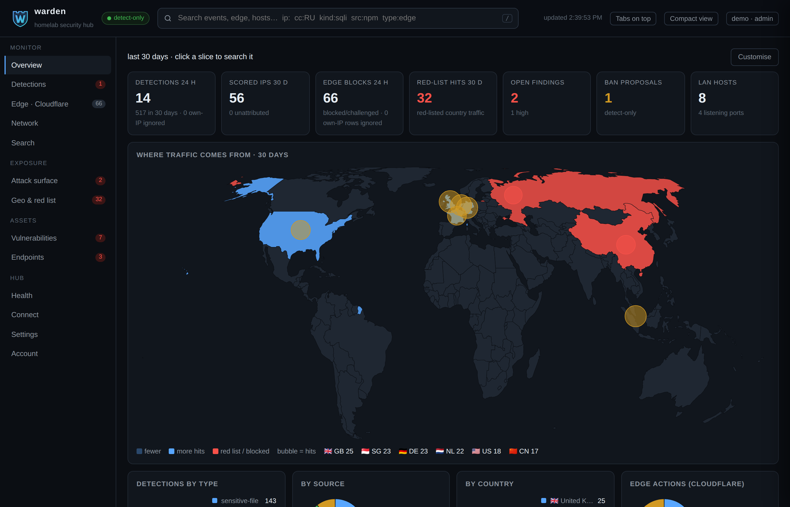
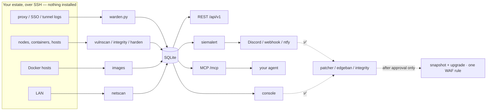

# warden

A lightweight, self-hosted security console for a homelab or small estate. It reads reverse-proxy and SSO logs, sweeps your LAN, scans containers for vulnerabilities, watches files for drift, tracks AI-agent activity, and offers Cloudflare edge bans — everything detect-only until you approve.



*The overview on demo data (`tools/demo.py`: documentation addresses only). Every chart and number can be swapped.*

## Contents

- [What it does](#what-it-does)
- [Quick start](#quick-start)
- [Usage](#usage)
- [Configuration](#configuration)
- [Connect your agent](#connect-your-agent)
- [How it works](#how-it-works)
- [Incidents (shadow mode)](#incidents-shadow-mode)
- [Security model](#security-model)
- [Status, limits and real results](#status-limits-and-real-results)
- [Roadmap](#roadmap)
- [Support and licence](#support-and-licence)

## What it does

- **Log detection.** Scores HTTP access and authentication logs (NPMplus, Caddy, Traefik, Authentik, Authelia, cloudflared) for path traversal, SQL injection, scanner agents, auth failures and more. Proposes per-IP and /24 subnet bans at the Cloudflare WAF edge. Never bans private ranges or Cloudflare.
- **LAN discovery.** ARP sweep every 15 minutes, daily port scan, new-device and IP-conflict alerts, with a learning window so sleeping devices do not trigger pages.
- **Vulnerability scanning.** Agentless: copies package metadata off each host over SSH and matches it against [OSV.dev](https://osv.dev), plus Alpine's secdb. Ranks by CISA known-exploited, then FIRST EPSS, then severity. Marks which boxes and containers are publicly reachable. Optional AI "fix first" briefing from any OpenAI-compatible endpoint; if the briefing names anything not in the scan it is withheld. Also checks NAS firmware against the vendor's latest release.
- **Patching.** Turns a request into a plan (packages, removals, snapshot, reboot) and waits for your approval. Snapshots containers first. Holds core services for the night window. Never auto-reboots a hypervisor.
- **Heartbeat and sign-ins.** Every 5 minutes: up, down, stopped or unknown. Who last signed in over SSH, the web console or a still-open `pct exec` / `lxc-attach`, failed sign-ins counted, a 7-day list. A Proxmox node covers all its containers in one SSH call.
- **File integrity and hardening.** Agentless file baselines with approval-to-accept. Weekly Lynis hardening score per box, run from a temporary directory and never left installed.
- **Internet health.** Router, internet, DNS and web checks every minute, with line usage and the busiest devices when it degrades.
- **AI agent tracking.** Attributes every outbound connection on each agent host to the agent that made it, flags destinations seen in threat feeds, records what each agent can access (user, groups, Linux capabilities, sudo, readable secrets), and keeps a destination history. Detect-only, read-only.
- **Network IDS.** Pulls Suricata alerts; checks router DNS and connection logs against threat feeds. Both optional.
- **Console.** Six tabs (Overview, Review, Threats, Agents, Posture, Settings), roles and optional 2FA login, unified search, a query builder, per-collector health, customisable home page, and an approval queue.

Every optional feature switches itself off when its config section is absent.

## Quick start

Full step-by-step setup, tested every week on a fresh machine: [docs/SETUP.md](docs/SETUP.md).

```sh
git clone https://github.com/casareanderson/warden.git /opt/warden
cd /opt/warden
sudo apt install python3-yaml python3-requests nmap
./warden-setup init                 # estate, alerts, machines, Cloudflare → warden.yml
./warden-setup check --hosts        # asks the running system what works
sudo ./warden-setup units --install # writes + enables only the timers for features you use
```

Then make yourself an admin and open the console:

```sh
./warden-setup user add YOUR-NAME --role admin   # prints a one-time password; you pick your own at first sign-in
```

The console binds to `127.0.0.1:8792`; put HTTPS (a reverse proxy) in front of it. Want to look before you wire anything up?

```sh
WARDEN_DATA=/tmp/warden-demo python3 tools/demo.py
WARDEN_DATA=/tmp/warden-demo ./warden-setup user add demo --role admin
WARDEN_DATA=/tmp/warden-demo python3 warden-ui.py   # http://127.0.0.1:8792, sign in as demo
```

## Usage

Run individual modules manually (the systemd timers do this automatically):

| Command | What it does |
|---|---|
| `python3 warden.py` | Collect logs, score events, propose bans |
| `python3 vulnscan.py` | Scan hosts and container images against OSV.dev |
| `python3 netscan.py` | ARP discovery and port sweep |
| `python3 patcher.py` | Build patch plans from outstanding requests |
| `python3 integrity.py` | Run file-baseline comparisons |
| `python3 harden.py` | Weekly Lynis hardening audit (`--list` scores) |
| `python3 agents.py` | Track outbound connections on an agent host |
| `python3 incidents.py` | Correlate detectors into incidents (`--report` measures accuracy) |
| `python3 heartbeat.py` | Ping every box, record who signed in |
| `python3 cfsec.py` | Check Cloudflare zone settings |

Check configuration without applying changes:

```sh
./warden-setup check --hosts          # verify SSH connectivity
./warden-setup check --all            # include optional integrations
```

Start or stop the console:

```sh
sudo systemctl enable --now warden-console.service
# or:  sudo systemctl disable --now warden-console.service
```

Connect your AI agent (MCP) and query:

```sh
claude mcp add --transport http warden https://warden.example.com/mcp \
  --header "Authorization: Bearer ***"
curl -H "Authorization: Bearer ***" https://warden.example.com/api/v1/summary
```

MCP tools available: `warden_summary`, `warden_detections`, `warden_top_ips`, `warden_lookup_ip`, `warden_search`, `warden_bans`, `warden_vulnerabilities`, `warden_attack_surface`, `warden_network`, `warden_ids`, `warden_integrity`, `warden_health`. REST views mirror them at `/api/v1/<view>`.

## Configuration

`warden-setup init` writes `warden.yml`; [warden.yml.example](warden.yml.example) documents every key. Optional sections, each toggling a subsystem on or off.

| Section | Purpose |
|---|---|
| `enforce`, `ban_threshold`, `allow`, `window_minutes`, `subnet_threshold`, `subnet_min_ips` | Detection thresholds, ban windows, and your own IPs (never banned). |
| `estate` | Name, public domain, LAN ranges, timezone, the box warden runs on. |
| `sources` | Where the logs are: `ssh: user@host` (or `local`) and an optional Docker `container`. |
| `hosts` | Machines to scan and patch: `proxmox`, `docker`, `linux` or `local`. |
| `notify` | `discord`, `webhook`, `ntfy` or `none`. |
| `secrets` | Names only. Values come from the environment, `data/secrets.env` (mode 600) or Infisical. |
| `cloudflare` | Optional zone settings: `zone_id`, `account_id`, token secret. |
| `ids` | Suricata host and log path. |
| `router` | Read-only SSH to an OpenWrt-style router for DNS and connection logs. |
| `ui` | Console bind address, auth mode (`local`, `proxy`, `basic`), session timeouts. |
| `api` | Public URL agents use to reach the REST API and MCP endpoint. |
| `agents` | Whether to watch the local box, learning window, agent name patterns, and secret files to report. |
| `patch` | Night-window time, proposal expiry, snapshot retention. |
| `vuln.brief` | Optional AI briefing endpoint and model. |
| `dashboard.widgets` | Custom home page layout (`null` = default). |
| `exposure` | Reverse-proxy routes the API cannot auto-discover (hand-written extras). |

## Connect your agent

Create a token (**Settings → Connect an agent → New token**, or `./warden-setup token hermes`). Point your agent at `/mcp` with a bearer token:

```yaml
# Hermes: ~/.hermes/config.yaml → mcp_servers
warden:
  url: https://warden.example.com/mcp
  headers:
    Authorization: "Bearer ${WARDEN_TOKEN}"
```

```sh
# Claude Code
claude mcp add --transport http warden https://warden.example.com/mcp \
  --header "Authorization: Bearer ***"

# anything else
curl -H "Authorization: Bearer ***" https://warden.example.com/api/v1/summary
```

If your reverse proxy has a login page, let `/mcp` and `/api/v1` straight through — an MCP client has no browser and cannot follow a login redirect.

Tools are read-only; a test fails if any tool name contains a write verb. The console has five minor write paths (layout, approvals, tokens, configs, secrets), all same-origin only and requiring an `X-Warden` header.

## How it works



Everything shares one SQLite file. Collectors run on systemd timers; the console, API and MCP read that file and nothing else. Three lessons built into the detector:

1. **An event's time is the time in the log line.** First ingest reads weeks of backlog; stamped "now", old history would fall inside the ban window.
2. **A fixed `--since 10m` under a 5-minute timer double-counts.** Collectors keep real watermarks plus a content hash against restarts and rotation.
3. **A per-IP threshold misses subnet spread.** The /24 roll-up catches seven addresses each under the line.

```
warden/
├── warden.py            log collectors, scoring, ban proposals
├── warden-ui.py/.html   console + REST API + MCP
├── warden-setup         init, check, add-host, tokens, connect, units
├── wlib/                config, secrets, notify/approvals, hosts, views, mcp, tokens, setup, units
├── netscan.py vulnscan.py images.py patcher.py integrity.py harden.py
├── intel.py edgeban.py cfsec.py netids.py netintel.py siemalert.py geo.py warden-facts.py
├── incidents.py heartbeat.py agents.py
├── edge-sentry/         report-only Cloudflare Worker (+ 11 offline tests)
├── tools/demo.py        demo data for screenshots and try-outs
├── tests/               36 tests: API, MCP traps, read-only guard, hosts, patch timing, intel
└── KNOWN-ISSUES.md      read before enforce: true
```

## Incidents (shadow mode)

Every detector used to alert on its own: an address probing `/.env` at Cloudflare, failing SSO logins, then signing in over SSH was three unrelated messages. `incidents.py` (timer, every 10 minutes) joins signals from the log detector, the Cloudflare edge, Suricata, threat intelligence, device behaviour, integrity drift, sign-ins and the heartbeat into incidents: one per outside /24, box or device, with a stable id on every fact.

In shadow mode only, a model picks one action per incident from a fixed list: `ignore_learn`, `watch`, `ask_owner`, `propose_edge_block`, `propose_patch_now` or `check_box`, with a confidence and two sentences of reasoning. Anything it writes that isn't in the facts (a number, an address, a name, a CVE) gets one repair round and is then withheld. Decisions are shown in the console and over MCP/REST, and never carried out or sent anywhere. Next to each decision warden records what you actually decided, and `incidents.py --report` measures how often the model agreed. First run on the author's estate: 73 incidents from 7 days, 10 decisions, none withheld, under a fifth of a US cent; it agreed with the owner on 2 of the 5 incidents the owner had already judged.

```yaml
incidents:
  mode: shadow        # shadow | off
  min_weight: 8       # lighter incidents are listed but never sent to the model
  max_decisions: 20   # model calls per run; unchanged incidents are never re-asked
```

## Security model

- **The console has its own sign-in** (`ui.auth: local`): scrypt-hashed passwords, HttpOnly/SameSite=Strict/Secure cookies, idle and absolute timeouts, lockout after 5 misses plus a per-address limit, optional TOTP 2FA, and roles checked on the server for every change. There is no web sign-up. Disabling or demoting someone ends their sessions immediately.
- **Detect-only by default.** `enforce: false` records what warden would ban and changes nothing.
- **Nothing acts without you.** Patching, edge blocks and baseline changes each need an explicit approval, expire if ignored, and are logged with who decided.
- **Agents read; people decide.** MCP and REST are read-only, enforced by a test.
- **Tokens are hashed at rest** (`wdn_` + 32 random bytes, SHA-256 stored), counted on every use, revocable at once.
- **Browser writes are same-origin only** and require an `X-Warden` header.
- **Secrets are names in config, never values.** Values live in the environment, a mode-600 file, or a secret manager.
- **Agentless.** Scans copy package metadata off a box; Lynis runs from a temporary directory and is removed.

## Status, limits and real results

Status: v3.3, running in detect-only mode on the author's estate since September 2026. It is a second opinion, not a replacement for CrowdSec or a WAF: it reads what they miss.

Measured on that estate:

- **The loudest signal was the owner.** In one week, 27 of 29 application-layer events came from the estate's own WAN address: a phone photo app requesting thumbnails for deleted assets.
- **ARP sees only what is awake.** Two sweeps twelve minutes apart found 48 then 46 devices; six "new" ones were bulbs and a TV that had been asleep. That is why `learn_hours` exists.
- **Percent-encoding defeats a naive WAF rule.** `union select` never matches `union%20select`. Both the Worker and the proposed rule now decode first.
- **Raw CVE counts are mostly noise.** One container had 4,592 findings and 0 with a fix available, which is why the console leads with fixable and known-exploited.

Known limits (full list in [KNOWN-ISSUES.md](KNOWN-ISSUES.md)): the Cloudflare WAF enforcement path (ban and unban alike) is unit-tested but still not battle-tested on a live account; a broken SSH connection to a log host is flagged `blind` on the Health tab rather than reading as a quiet log; log formats assume NGINX/NPMplus, Authelia, cloudflared, Caddy (JSON), Traefik (CLF) and Authentik.

## Roadmap

- **Cloud connectors:** read-only posture checks for your own cloud accounts.
- **An evolve agent:** watches security advisories and tool trends, proposes improvements to warden's own rules with the same approval flow.
- **Crawl-aware agent tracking.** Classify *how* an agent reaches out — headless Chromium, Playwright, Puppeteer, crawl4ai, scrapy, curl, Python requests, Node.js — all read from `/proc`. Tags known crawl/scrape SaaS destinations as a category.
- **Inbound AI-crawler tracking.** Identify AI crawlers hitting public sites by declared user-agent (GPTBot, ClaudeBot, CCBot, PerplexityBot, Google-Extended, Bytespider, Amazonbot) and show which bot crawled which hostname, how often, and whether it honoured robots.txt.

## Support and licence

Copyright (c) 2026 Christian Asare-Anderson. Licensed under the GNU Affero General Public License v3.0, see [LICENSE](LICENSE). If you run a modified warden as a network service, the AGPL requires you to offer your users the modified source. For a commercial licence without those terms, open an issue.

Versions up to and including commit `48f2ba1` (2026-10-08) were released under MIT and remain available under MIT; everything after is AGPL-3.0 only. IP geolocation by [DB-IP](https://db-ip.com) (CC BY 4.0). `netscan.py` calls [nmap](https://nmap.org) under its own licence. Vulnerability data: [OSV.dev](https://osv.dev) (CC-BY 4.0 and per-source licences) and Alpine secdb. Cloudflare IP ranges are Cloudflare's published list.
